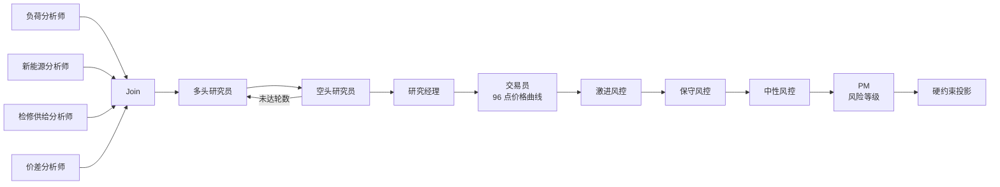

# 电力现货多智能体复盘系统

面向电力现货市场的多智能体复盘系统：负荷、新能源、检修、价差四类分析师并行分析，经多空辩论、研究经理汇总、交易员生成 96 点价格曲线，再由风险委员会与 PM 决策，最终通过硬约束投影输出可申报曲线。

**技术栈**：Python · LangGraph · Qwen3.8-Flash（OpenAI 兼容）· Pydantic  
**作者**：石家旭

## 1. 背景

电力现货每天 96 个结算时段，价格同时受负荷、新能源出力、检修、天气、政策与市场情绪影响。单个大 Prompt 难以同时处理多源信号、冲突观点和可申报硬约束。本项目把复盘拆成多个角色，让每个角色只处理一类信号，并用图结构保证流程可控、可解释、可校验。

## 2. 架构



- 分析师并行，`Join` 汇合后进入辩论；`State` 用 reducer 合并报告、辩论与风控意见。
- 条件边控制辩论轮数（`round < max_debate_rounds`）。
- 研究经理与 PM 使用 Pydantic 结构化输出；解析失败时回退 JSON 解析。

## 3. 角色设计

| 角色 | 关注点 | 输出 |
|---|---|---|
| 负荷分析师 | 负荷峰值 / 谷值、峰值时间 | 峰 / 谷 / 平方向 |
| 新能源分析师 | 风光出力、净负荷、午间压价 | 峰 / 谷 / 平方向 |
| 检修供给分析师 | 检修容量、供给裕度 | 峰 / 谷 / 平方向 |
| 价差分析师 | 昨日高价 / 低价、分段均价、峰谷形态 | 峰 / 谷 / 平方向 |
| 多头 / 空头研究员 | 基于分析师报告辩论 | 双方论据 |
| 研究经理 | 综合报告与辩论 | 分段方向 + 置信度 |
| 交易员 | 把方向映射为 96 点曲线 | 96 点价格 |
| 风控委员会 | 收益 / 偏差 / 约束 | 风险意见 |
| PM | 风险等级与最终解释 | 最终曲线 |

## 4. 96 点输出与硬约束

LLM 只输出峰 / 谷 / 平三段的方向与置信度；交易员用规则把方向映射成 96 点曲线；风控层做投影约束：

| 约束 | 实现 |
|---|---|
| 逐点 ±30% | 相对昨日 96 点价格逐点裁剪 |
| 分段 ±20% | 峰 / 谷 / 平三段均值裁剪 |
| 全天 ±15% | 日均值裁剪 |
| 价格区间 [40,650] | 逐点裁剪 |
| 相邻跳变 ≤20 | 前向 + 后向投影，迭代收敛 |

投影顺序：分段缩放 → 日均缩放 → 逐点裁剪 + 双向跳变投影，循环至收敛。

## 5. 评测

**数据**：6 天合成 96 点负荷 / 风电 / 光伏 / 检修 / 电价；3 个目标日；目标日实际价格只用于打分，不输入 Agent。

**对比**：多 Agent（11 次 LLM 调用 / 日）、单 Agent（1 次调用 / 日）、不变化基线、always-flat。

| 指标 | 多 Agent | 单 Agent | 不变化基线 | always-flat |
|---|---|---|---|---|
| 分段方向正确 | 3/9 | 3/9 | - | 7/9 |
| MAE（元/MWh） | 11.14 | 10.21 | 7.04 | - |
| 平均时延 | 132.4 s | 71.7 s | - | - |
| 约束违规 | 0 | 0 | - | - |

**结论**：

- 9 个「日 × 段」中 7 个实际为 flat（变化 <2%），多 Agent 与单 Agent 都持续预测 up/down，方向准确率只有 3/9。
- 引入 always-flat 基线（7/9）后，定位到模型的「过度方向性」问题，而不是编排失效。
- MAE 也不如不变化基线，说明弱信号数据上方向调整会放大误差。
- 工程侧目标达成：96 点曲线在 5 类硬约束下 0 违规。

## 6. 我的工作

- 设计四类分析师、辩论、研究经理、交易员、风控与 PM 的角色分工与图编排。
- 实现共享 State、reducer 合并、条件边控轮数与结构化输出。
- 实现 96 点曲线生成与 5 类硬约束投影，并通过 mock 图测试与 3 天回测验证 0 违规。
- 搭建多 Agent / 单 Agent / 不变化 / always-flat 四组对比与负结果分析。
- 数据层、提示词、评测脚本与文档均为本项目实现。

## 7. 快速开始

```bash
cd tradingagents-power
uv venv --python 3.12 .venv
uv pip install --python .venv/Scripts/python.exe langgraph langchain-openai pydantic
# 设置 DASHSCOPE_API_KEY 后：
.venv/Scripts/python.exe test_graph_mock.py   # 图拓扑 + 约束，不调用 API
.venv/Scripts/python.exe run_power.py          # 3 天回测
```

## 8. 项目结构

```
tradingagents-power/
├── power_data.py         # 合成 96 点数据
├── power_graph.py        # 角色、图、约束
├── run_power.py          # 3 天回测
├── test_graph_mock.py    # mock LLM 图测试
└── results/              # 回测结果
```

## 9. 设计取舍

- **LLM vs 代码**：LLM 负责方向判断，代码负责数值生成与约束；避免 LLM 直接输出 96 个数导致格式错误 / 越界。
- **共享 State vs 子图隔离**：本项目用共享 State + reducer，保证上下文一致；代价是长链路可能污染。TradingAgents 用私有消息子图隔离分析师，适合并行分析。
- **为什么不用一个大 Prompt**：多源信号易漏、无法并行、出错不可定位、无法做硬约束。

## 10. 局限与后续

- 合成数据、3 个交易日、单模型；结论只代表该设置。
- 后续：公开省级现货数据扩到 20–35 天；flat 阈值 / 置信度校准；成本 / 时延统计；把约束投影做成单元测试。

## 11. 相关工作

- [TradingAgents](https://github.com/TauricResearch/TradingAgents)：本项目参考其「分析师 → 多空辩论 → 交易员 → 风险委员会 → PM」的角色分工与条件边设计；代码为独立实现，未 fork 原仓库；数据层、角色、96 点输出、硬约束与评测均为本项目新增。
